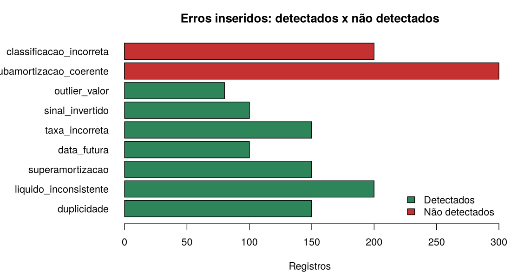
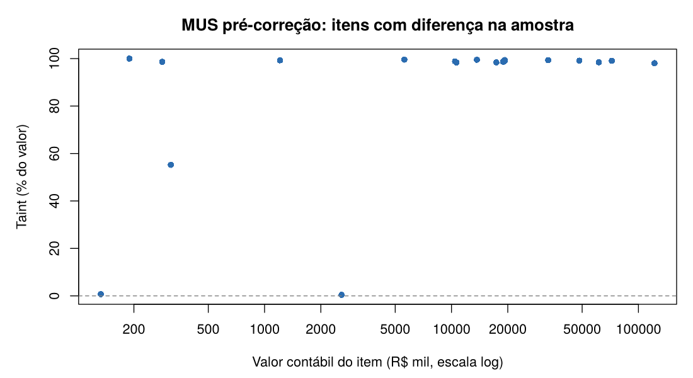
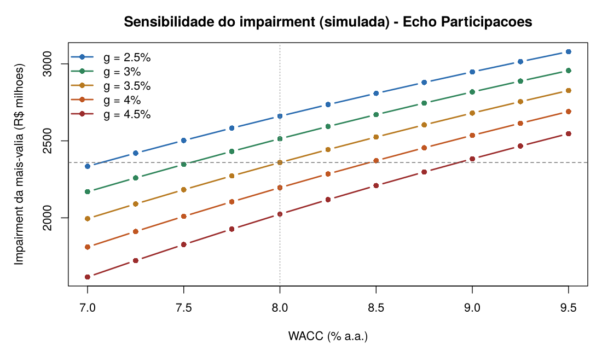

# 1. Sumário executivo

Este dossiê **substitui integralmente** o trabalho anterior, que usava valores de uma controlada (Equatorial Maranhão/Pará/Piauí) e uma materialidade de 1% de R$ 15.199.199 mil sem relação com o consolidado. A entidade correta é a **holding Equatorial S.A.** (antes Equatorial Energia S.A.), com demonstrações **consolidadas** de 31/12/2025.

| Item | Valor |
|---|---|
| Receita operacional líquida (DRE p.11) | R$ 52.073.804 mil |
| Total do ativo (BP p.10) | R$ 109.603.944 mil |
| **Conta-alvo: Intangível (BP p.10; Nota 14 p.63)** | **R$ 31.729.991 mil (28,9% do ativo)** |
| Materialidade global / execução / trivial | R$ 260.000 / 195.000 / 13.000 mil |
| Base simulada | 525.150 registros (limpa: 525.000), reconciliada à Nota 14 |
| Erros inseridos / detectados | 1430 / 930 (recall 65%; precisão 99.6%) |
| MUS pré-correção | 18 erros na amostra; LS R$ 1.724.180 mil > ME R$ 195.000 mil |
| MUS pós-correção | 0 erros; LS R$ 194.723 mil ≤ ME |

**Natureza dos 27 PTs** (classificação oficial das instruções):

| Natureza | Quantidade de PTs |
|---|---|
| Planejado por falta de acesso | 2 |
| Realizado com evidência pública | 14 |
| Simulado para fins didáticos | 11 |

**Achados principais:** (i) diferença de R$ 855.050 mil entre a base e a Nota 14, explicada em R$ 854.668 mil pelos testes (PT 500); (ii) diferença de R$ 156.591 mil entre o total do impairment e seus componentes na DFP (PT 315/PT 500); (iii) diferença não explicada de R$ 720.175 mil na amortização de Distribuição - Em serviço (PT 520); (iv) impairment sensível: WACC +1 p.p. aumenta a perda em R$ 321.085 mil, acima da materialidade global (PT 540).

# 2. Entidade, escopo e fontes (PT 200, PT 230, PT 300)

**Identificação:** denominação atual **Equatorial S.A.** (anteriormente Equatorial Energia S.A., conforme a lista do professor); código de negociação **EQTL3** na B3, Novo Mercado desde 2008 (Nota 1, PDF p.16). A data da mudança de denominação não foi confirmada em fonte pública (pendência P-01). Auditor da companhia: Ernst & Young Auditores Independentes S/S Ltda.; relatório de 25/03/2026.

**Escolha da conta (instrução §3):** a conta de maior materialidade do ativo é o **Intangível**, 28,9% do ativo total, maior que o ativo financeiro da concessão (17,5%):

| conta | saldo_2025_mil | pagina_pdf | pct_ativo_total | vezes_materialidade_global | escolhida |
|---|---|---|---|---|---|
| Intangível | 31.729.991 | 10 (Nota 14) | 28,9 | 122 | SIM - maior saldo individual do ativo (28,9%) |
| Ativo financeiro da concessão | 19.135.756 | 10 (Nota 12) | 17,5 | 74 |  |
| Contas a receber de clientes (circ. + não circ.) | 10.315.564 | 10 (Nota 6) | 9,4 | 40 |  |
| Imobilizado | 6.540.907 | 10 (Nota 13) | 6 | 25 |  |
| Caixa e equivalentes | 2.659.827 | 10 (Nota 4) | 2,4 | 10 |  |
| Almoxarifado | 291.436 | 10 | 0,3 | 1 |  |

Fatos extraídos da DFP, com página do PDF (página impressa = PDF − 2):

| id_fato | conta | valor_2025_mil | valor_2024_mil | pagina_pdf | referencia |
|---|---|---|---|---|---|
| F01 | Receita operacional liquida (consolidado) | 52.073.804 | 43.760.753 | 11 | DRE |
| F02 | Resultado antes do IR e CS (consolidado) | 2.455.004 | 2.743.305 | 11 | DRE |
| F03 | Lucro liquido do exercicio (consolidado) | 2.503.931 | 3.767.805 | 11 | DRE |
| F04 | Total do ativo (consolidado) | 109.603.944 | 116.412.092 | 10 | BP |
| F05 | Patrimonio liquido total (consolidado) | 28.327.947 | 29.887.586 | 10 | BP |
| F06 | Intangivel (consolidado) - maior conta do ativo nao circulante; conta-alvo do trabalho | 31.729.991 | 32.373.681 | 10 | BP / Nota 14 |
| F07 | Ativo financeiro da concessao | 19.135.756 | 15.865.088 | 10 | BP / Nota 12 |
| F08 | Imobilizado | 6.540.907 | 7.579.662 | 10 | BP / Nota 13 |
| F09 | Caixa e equivalentes de caixa | 2.659.827 | 3.306.364 | 10 | BP / Nota 4 |
| F10 | Contas a receber de clientes - circulante | 9.491.337 | 8.538.999 | 10 | BP / Nota 6 |
| F11 | Almoxarifado | 291.436 | 150.896 | 10 | BP |
| F12 | Total do ativo circulante | 26.604.996 | 28.527.347 | 10 | BP |
| F13 | Total do passivo circulante | 17.803.899 | 19.605.210 | 10 | BP |
| F14 | Emprestimos e financiamentos (circ.+ nao circ.) | 20.978.503 | 26.904.571 | 74 | Nota 18.2 |
| F15 | Debentures (circ. 913.945 + nao circ. 32.579.315) | 33.493.260 | 28.922.507 | 10 | BP / Nota 19 |
| F16 | Provisao para riscos judiciais (circ. 1.551.426 + nao circ. 3.198.308) | 4.749.734 | 5.301.015 | 10 | BP / Nota 23 |
| F17 | Intangivel - custo (Nota 14) | 63.772.976 |  | 63 | Nota 14 |
| F18 | Intangivel - amortizacao acumulada (Nota 14) | -28.256.389 |  | 63 | Nota 14 |
| F19 | Intangivel - obrigacoes vinculadas a concessao (Nota 14) | -3.786.596 |  | 63 | Nota 14 |
| F20 | Intangivel - valor liquido (Nota 14) | 31.729.991 |  | 63 | Nota 14 |
| F21 | Intangivel - Em servico Distribuicao: custo 14 vs 14.1 | 50.098.143 | 50.099.884 | 63 | Nota 14 vs 14.1 |
| F22 | Intangivel - amortizacao do exercicio (Nota 14.1) | -2.964.751 |  | 65 | Nota 14.1 |
| F23 | Perda por impairment no intangivel (Nota 14.1) | -2.659.780 |  | 65 | Nota 14.1 |
| F24 | Impairment total declarado (Nota 16) | 3.391.261 | 0 | 68 | Nota 16 |
| F25 | Impairment - componentes (CSA 308.806 + Echo 879.781 + mais-valia 2.359.265) | 3.547.852 | 0 | 68 | Nota 16 |
| F26 | Mais-valia Echo Participacoes - valor recuperavel | 4.053.163 |  | 69 | Nota 16 |
| F27 | WACC antes de impostos - Echo Participacoes | 8 |  | 69 | Nota 16.1 |
| F28 | Contas a receber bruto (Nota 6) | 14.603.816 | 13.421.251 | 42 | Nota 6.1 |
| F29 | PECLD (Nota 6) | -4.288.252 | -3.997.455 | 42 | Nota 6.1 |
| F30 | Receita de construcao - distribuicao | 10.601.331 | 8.377.887 | 103 | Nota 27 |
| F31 | Receita de construcao - saneamento | 105.029 | 155.580 | 103 | Nota 27 |
| F32 | Receita nao faturada (KAM) | 1.546.475 | 1.318.952 | 4 | Relatorio do auditor / Nota 6 |
| F33 | Covenant divida liquida/EBITDA (limite <= 4,5; apurado entre 1,8 e 2,8) | 4,5 |  | 77 | Nota 18.6 |
| F34 | Amortizacao e depreciacao (DFC) | 2.754.796 |  | 14 | DFC |

# 3. Materialidade (PT 320)

Seis benchmarks foram calculados e comparados (NBC TA 320):

| base | valor_mil | mat_min_mil | mat_max_mil |
|---|---|---|---|
| Receita operacional liquida (ROL) | 52.073.804 | 260.369 | 520.738 |
| ROL excl. receita de construcao (Nota 27) | 41.367.444 | 206.837 | 413.674 |
| Resultado antes de IR/CS (LAIR) 2025 | 2.455.004 | 122.750 | 122.750 |
| LAIR medio 2024-2025 | 2.599.154,5 | 129.958 | 129.958 |
| Total do ativo | 109.603.944 | 548.020 | 1.096.039 |
| Patrimonio liquido | 28.327.947 | 283.279 | 566.559 |

| item | valor_mil | criterio |
|---|---|---|
| Materialidade global (DFs como um todo) | 260.000 | 0,5% da ROL 2025 (R$ 52.073.804 mil), arredondada |
| Materialidade de execucao (75%) | 195.000 | 75% da global |
| Limite de distorcoes triviais (5%) | 13.000 | 5% da global |
| Materialidade especifica (50%): partes relacionadas, covenants e divulgacao de impairment | 130.000 | 50% da global |
| Erro tolerável (ME) para MUS no Intangivel = materialidade de execucao | 195.000 | igual a execucao |

> JUSTIFICATIVA (NBC TA 320 itens 10-11, A3-A8):
> 1. A materialidade e determinada para o CONSOLIDADO (todas as demonstracoes), nao para uma conta isolada. Base escolhida: ROL 2025 = R$ 52.073.804 mil; percentual 0,5% = R$ 260.369 mil, arredondado para R$ 260.000 mil.
> 2. O LAIR (R$ 2.455.004 mil) foi descartado como base principal: 5% daria R$ 122.750 mil, valor influenciado por impairment (R$ 3,39 bi) e pela baixa de transmissao (operacao descontinuada) - base volatil e nao representativa do tamanho da entidade.
> 3. O ativo total (R$ 109,6 bi) a 0,5% daria R$ 548.020 mil: acima da adotada; a ROL e mais sensivel ao uso das demonstracoes por investidores e credores (covenants de divida liquida/EBITDA).
> 4. Excluindo receita de construcao (R$ 10.706.360 mil), 0,5% da ROL daria R$ 206.837 mil: a adotada fica 25.7% acima; aceito porque a receita de construcao tem margem proxima de zero mas integra a ROL publicada.
> 5. Cobertura do Intangivel: a materialidade de execucao (R$ 195.000 mil) equivale a 0.615% do saldo; dai o numero de itens do MUS (PT20).
> 6. Julgamento revisavel: se os usuarios principais forem credores, o LAIR/EBITDA passa a ser mais relevante; registrar no PT11 e rever apos o PT10.

# 4. Base de dados simulada (PT 500, PT 230)

A base reproduz **linha a linha** a Nota 14 (custo R$ 63.772.976 mil; amortização R$ −28.256.389 mil; obrigações vinculadas R$ −3.786.596 mil; líquido R$ 31.729.991 mil). A abertura em registros individuais é **simulada** (semente 242010937). Dicionário e premissas: `dados/dicionario_dados.csv` e `dados/premissas_base.csv`.

# 5. Testes, erros inseridos e detectados (PT 240, PT 265, PT 450, PT 500)

Foram inseridos 1.430 erros em nove tipos (log em `dados/log_erros_inseridos.csv`). Os tipos **E8** e **E9** foram desenhados para escapar dos testes aritméticos.

| tipo_erro | inseridos | detectados | nao_detectados | recall_pct | distorcao_total_mil | distorcao_nao_detectada_mil |
|---|---|---|---|---|---|---|
| E1_duplicidade | 150 | 150 | 0 | 100 | 11.691 | 0 |
| E2_liquido_inconsistente | 200 | 200 | 0 | 100 | 39.971 | 0 |
| E3_superamortizacao | 150 | 150 | 0 | 100 | 14.239 | 0 |
| E4_data_futura | 100 | 100 | 0 | 100 | 0 | 0 |
| E5_taxa_incorreta | 150 | 150 | 0 | 100 | 0 | 0 |
| E6_sinal_invertido | 100 | 100 | 0 | 100 | 9.177,7 | 0 |
| E7_outlier_valor | 80 | 80 | 0 | 100 | 808.235,5 | 0 |
| E8_subamortizacao_coerente | 300 | 0 | 300 | 0 | 382,1 | 382,1 |
| E9_classificacao_incorreta | 200 | 0 | 200 | 0 | 0 | 0 |

| medida | valor |
|---|---|
| Erros inseridos | 1.430 |
| Detectados (VP) | 930 |
| Nao detectados (FN) | 500 |
| Sinalizados que nao sao erros (FP) | 4 |
| Recall (%) | 65 |
| Precisao (%) | 99,6 |

**Leitura crítica (C5/C6):** o recall de 100% em E1-E7 é em parte circular, pois os testes foram desenhados a partir dos tipos inseridos. O resultado informativo é o que **escapa**: E8 e E9 (500 registros) só seriam encontrados com evidência externa ou procedimento analítico/estimativa.

# 6. Reconciliações (PT 500, PT 510)

Base com erros x Nota 14, por linha:

| linha_nota14 | dfp_liquido_mil | base_liquido_mil | diferenca_mil | dif_pct |
|---|---|---|---|---|
| DC - Alagoas | 926.528 | 961.462,1 | 34.934,1 | 3,8 |
| DC - CEA | 1.036.631 | 1.041.863,8 | 5.232,8 | 0,5 |
| DC - CEEE-D | 2.263.680 | 2.292.220,0 | 28.540,0 | 1,3 |
| DC - Maranhao | 73.050 | 79.005,7 | 5.955,7 | 8,2 |
| DC - Para | 2.002 | 9.207,8 | 7.205,8 | 359,9 |
| DC - Piaui | 1.298.536 | 1.357.095,7 | 58.559,7 | 4,5 |
| Dist - Em servico | 23.394.689 | 23.979.697,1 | 585.008,1 | 2,5 |
| Dist - Outros | 90.700 | 92.732,1 | 2.032,1 | 2,2 |
| Ger - Direito de autorizacao | 2.091.299 | 2.211.867,6 | 120.568,6 | 5,8 |
| Ger - Direito de exploracao | -165.415 | -165.415 | 0 | 0 |
| Ger - Outros | 63.812 | 64.963,9 | 1.151,9 | 1,8 |
| San - DC CSA | 639.136 | 644.997,6 | 5.861,6 | 0,9 |
| San - Outros | 15.343 | 15.343 | 0 | 0 |
| TOTAL | 31.729.991 | 32.585.041,5 | 855.050,5 | 2,7 |

DFP: Balanço x Nota 14 x Nota 14.1 x Nota 16:

| verificacao | valor_a | valor_b | diferenca | conclusao |
|---|---|---|---|---|
| BP (Intangivel) = Nota 14 total | 31.729.991 | 31.729.991 | 0 | Concilia |
| Nota 14 total = Nota 14.1 total (2025) | 31.729.991 | 31.729.991 | 0 | Concilia |
| Nota 14.1 2024 = BP 2024 | 32.373.681 | 32.373.681 | 0 | Concilia |
| Em servico: custo Nota 14 vs 14.1 | 50.098.143 | 50.099.884 | -1.741 | Diferenca - investigar |
| Em servico: amortizacao Nota 14 vs 14.1 | -22.916.858 | -22.918.599 | 1.741 | Diferenca - investigar |
| Em servico: liquido (apos obrigacoes) Nota 14 vs 14.1 | 23.394.689 | 23.394.689 | 0 | Concilia |
| Impairment no intangivel: Nota 14.1 (mais-valia + CSA) | -2.659.780 | -2.659.780 | 0 | Concilia |
| Impairment total: componentes x total declarado Nota 16 | 3.547.852 | 3.391.261 | 156.591 | Diferenca - investigar |

# 7. Amostragem por unidade monetária (PT 530, PT 450)

Parâmetros (população como registrada):

| parametro | valor |
|---|---|
| Populacao positiva (R$ mil) | 33.652.207,7 |
| Registros positivos | 500.317 |
| Registros com liquido = 0 (totalmente amortizados) | 2.801 |
| Registros com liquido < 0 | 22.032 |
| Soma liquido < 0 (R$ mil) | -1.067.166,3 |
| Erro toleravel ME (R$ mil) | 195.000 |
| Nivel de confianca | 0,9 |
| Fator de confianca (zero erros esperados) | 3 |
| Intervalo de amostragem J = ME/FC (R$ mil) | 65.000 |
| Itens-chave >= J (100%) | 2 |
| Valor dos itens-chave (R$ mil) | 193.894,1 |
| Valor do restante (R$ mil) | 33.458.313,6 |
| Tamanho da amostra MUS (restante) | 515 |
| Partida aleatoria | 45.343,6 |
| Semente | 242.010.943 |

Avaliação de Stringer - **pré-correção**:

| medida | superavaliacao | subavaliacao |
|---|---|---|
| Erros na amostra (n) | 18 | 0 |
| Precisao basica (R$ mil) | 194722.6 | 194722.6 |
| Incremento por erros (R$ mil) | 1338546.2 | 0 |
| Limite superior de erro da amostra (R$ mil) | 1533268.8 | 194722.6 |
| Melhor estimativa projetada (R$ mil) | 1002121.9 | 0 |
| Erro conhecido em itens-chave (R$ mil) | 190911.2 | 0 |
| Limite superior total (R$ mil) | 1724180 | 194722.6 |
| Erro toleravel ME (R$ mil) | 195000 | 195000 |
| Conclusao | LS > ME: nao ha base para concluir que o saldo esta livre de distorcao relevante; propor ajuste e ampliar testes | LS <= ME: amostra suporta a conclusao |

**Pós-correção** dos registros sinalizados:

| medida | superavaliacao | subavaliacao |
|---|---|---|
| Erros na amostra (n) | 0 | 0 |
| Precisao basica (R$ mil) | 194722.6 | 194722.6 |
| Incremento por erros (R$ mil) | 0 | 0 |
| Limite superior de erro da amostra (R$ mil) | 194722.6 | 194722.6 |
| Melhor estimativa projetada (R$ mil) | 0 | 0 |
| Erro conhecido em itens-chave (R$ mil) | 0 | 0 |
| Limite superior total (R$ mil) | 194722.6 | 194722.6 |
| Erro toleravel ME (R$ mil) | 195000 | 195000 |
| Conclusao | LS <= ME: amostra suporta a conclusao | LS <= ME: amostra suporta a conclusao |

Sensibilidade do tamanho da amostra (executada):

| ME_rotulo | conf | FC | J | n_aprox |
|---|---|---|---|---|
| ME = execucao | 0,90 | 2,30 | 84.783 | 397 |
| ME = execucao/2 | 0,90 | 2,30 | 42.391 | 791 |
| ME = global | 0,90 | 2,30 | 113.043 | 298 |
| ME = execucao | 0,95 | 3 | 65.000 | 517 |
| ME = execucao/2 | 0,95 | 3 | 32.500 | 1.030 |
| ME = global | 0,95 | 3 | 86.667 | 388 |
| ME = execucao | 0,99 | 4,61 | 42.299 | 793 |
| ME = execucao/2 | 0,99 | 4,61 | 21.150 | 1.579 |
| ME = global | 0,99 | 4,61 | 56.399 | 596 |

# 8. Estimativas e sensibilidade (PT 540)

Premissas **simuladas**: horizonte 20 anos, crescimento nominal 3,5%; fluxo calibrado ao valor recuperável de R$ 4.053.163 mil (Nota 16, p.69). Resultados de um fator:

| cenario | vu | impairment_mil | delta_mil | delta_x_materialidade | excede_materialidade |
|---|---|---|---|---|---|
| Base (WACC 8,00%; g 3,5%; 20 anos) | 4.053.163 | 2.359.265 | 0 | 0 | FALSE |
| WACC +0,50 p.p. | 3.887.625 | 2.524.803 | 165.538 | 0,6 | FALSE |
| WACC -0,50 p.p. | 4.229.481 | 2.182.947 | -176.318 | -0,7 | FALSE |
| WACC +1,00 p.p. | 3.732.078 | 2.680.350 | 321.085 | 1,2 | TRUE |
| g -1,0 p.p. | 3.752.201 | 2.660.227 | 300.962 | 1,2 | TRUE |
| g +1,0 p.p. | 4.388.071 | 2.024.357 | -334.908 | -1,3 | TRUE |
| Horizonte 15 anos | 3.337.192 | 3.075.236 | 715.971 | 2,8 | TRUE |
| Horizonte 25 anos | 4.631.896 | 1.780.532 | -578.733 | -2,2 | TRUE |
| FCF -10% | 3.647.847 | 2.764.581 | 405.316 | 1,6 | TRUE |
| FCF +10% | 4.458.479 | 1.953.949 | -405.316 | -1,6 | TRUE |

Vida útil (taxas ±10%/±20% sobre a despesa esperada):

| variacao_taxa | despesa_anual_mil | delta_mil | delta_x_materialidade |
|---|---|---|---|
| 0 | 2.504.456 | 0 | 0 |
| -0,2 | 2.003.565 | -500.891 | -1,9 |
| -0,1 | 2.254.011 | -250.446 | -1,0 |
| 0,1 | 2.754.902 | 250.446 | 1,0 |
| 0,2 | 3.005.348 | 500.891 | 1,9 |

# 9. Procedimentos analíticos (PT 520)

| classe | registrado_mil | esperado_mil | diferenca_mil | dif_pct | acima_limiar |
|---|---|---|---|---|---|
| Distribuicao - Em servico (bruto) | 2.974.983 | 2.003.972 | 971.011 | 48,5 | TRUE |
| Distribuicao - Obrigacoes especiais (reduz amortizacao) | 572.927 | 322.091 | 250.836 | 77,9 | TRUE |
| Distribuicao - Direito de concessao | 269.976 | 262.952 | 7.024 | 2,7 | FALSE |
| Saneamento - Direito de concessao CSA | 34.700 | 31.858 | 2.842 | 8,9 | FALSE |
| Geracao - Direito de autorizacao | 76.722 | 76.810 | -88 | -0,1 | FALSE |
| Distribuicao - Em servico, liquido de obrigacoes especiais | 2.402.056 | 1.681.881 | 720.175 | 42,8 | TRUE |

| indice | v2025 | v2024 | variacao_rel_pct | leitura |
|---|---|---|---|---|
| Crescimento da ROL | 0,1900 |  |  | ROL +19% a/a: receita de construcao (+25%), parcela A e CDE (Nota 27) |
| PECLD / contas a receber bruto | 0,2936 | 0,2978 | -1,4000 | Estavel; cobertura do PECLD sobre o bruto cerca de 29% |
| Prazo medio de recebimento (dias, CR liquido circ.+nc / ROL) | 72,3047 | 78,6021 | -8 | Prazo medio de recebimento cai de ~79 para ~72 dias |
| Intangivel / Ativo total | 0,2895 | 0,2781 | 4,1000 | Peso do Intangivel sobe: ativo total cai 5,9% (venda da transmissao) e Intangivel cai 2,0% (impairment de R$ 2,66 bi e transferencias) |
| Caixa / Ativo circulante | 0,1000 | 0,1159 | -13,7000 | Queda de caixa; liquidez ainda positiva |
| Capital circulante liquido (R$ mil) | 8.801.097 | 8.922.137 | -1,4000 | CCL positivo nos dois anos: sem indicio de continuidade (PT24) |
| Divida bruta (emprest.+deb.) / PL | 1,9229 | 1,8679 | 2,9000 | Alavancagem sobre PL; covenants contratuais sao liquida/EBITDA (Nota 18.6) |
| Receita de construcao / ROL | 0,2056 | 0,1950 | 5,4000 | Receita de construcao tem margem proxima de zero (ICPC 01) |
| Amortizacao e depreciacao (DFC) / ROL | 0,0529 | 0,0499 | 5,9000 | Despesa de amortizacao acompanha crescimento da base |

# 10. Matriz de cobertura (Estrutura Conceitual e NBC TA 200-600) e papéis de trabalho

| pt | versao_norma | titulo | natureza | status_cobertura |
|---|---|---|---|---|
| PT EC | Estrutura Conceitual para Trabalho de Asseguração (CFC, DOU 25/11/15) | Estrutura Conceitual para trabalhos de asseguração | Realizado com evidência pública | Executado com evidência pública |
| PT 200 | NBC TA 200 (R1), DOU 05/09/16 | Objetivos gerais, ética, independência e ceticismo | Realizado com evidência pública | Executado com evidência pública |
| PT 210 | NBC TA 210 (R1), DOU 05/09/16 | Termos do trabalho de auditoria | Simulado para fins didáticos | Executado em dados simulados |
| PT 220 | NBC TA 220 (R3), DOU 09/12/21 | Gestão da qualidade da auditoria | Planejado por falta de acesso | Planejado - pendente de acesso |
| PT 230 | NBC TA 230 (R1), DOU 05/09/16 | Documentação de auditoria | Realizado com evidência pública | Executado com evidência pública |
| PT 240 | NBC TA 240 (R1) aplicável ao exercício 2025. A R2 (DOU 25/09/26) só vale para períodos iniciados em ou após 01/01/2027 (CFC, notícia de 28/09/2026) | Responsabilidades do auditor quanto a fraude | Simulado para fins didáticos | Executado em dados simulados |
| PT 250 | NBC TA 250, DOU 14/02/19 | Leis e regulamentos | Realizado com evidência pública | Executado com evidência pública |
| PT 260 | NBC TA 260 (R2), DOU 04/07/16 | Comunicação com os responsáveis pela governança | Simulado para fins didáticos | Executado em dados simulados |
| PT 265 | NBC TA 265 (Res. CFC 1.210/09) | Comunicação de deficiências de controle interno | Simulado para fins didáticos | Executado em dados simulados |
| PT 300 | NBC TA 300 (R1), DOU 05/09/16 | Planejamento da auditoria | Realizado com evidência pública | Executado com evidência pública |
| PT 315 | NBC TA 315 (R2), DOU 02/09/21 | Identificação e avaliação dos riscos de distorção relevante | Realizado com evidência pública | Executado com evidência pública |
| PT 320 | NBC TA 320 (R1), DOU 05/09/16 | Materialidade no planejamento e na execução | Realizado com evidência pública | Executado com evidência pública |
| PT 330 | NBC TA 330 (R1), DOU 05/09/16 | Respostas do auditor aos riscos avaliados | Simulado para fins didáticos | Executado em dados simulados |
| PT 402 | NBC TA 402 (Res. CFC 1.215/09) | Organização prestadora de serviços | Planejado por falta de acesso | Planejado - pendente de acesso |
| PT 450 | NBC TA 450 (R1), DOU 05/09/16 | Avaliação das distorções identificadas | Simulado para fins didáticos | Executado em dados simulados |
| PT 500 | NBC TA 500 (R1), DOU 05/09/16 | Evidência de auditoria: reconciliações e testes de detalhes | Simulado para fins didáticos | Executado em dados simulados |
| PT 501 | NBC TA 501 (Res. CFC 1.218/09) | Considerações específicas sobre itens selecionados | Realizado com evidência pública | Executado com evidência pública |
| PT 505 | NBC TA 505 (Res. CFC 1.219/09) | Confirmações externas | Simulado para fins didáticos | Executado em dados simulados |
| PT 510 | NBC TA 510 (R1), DOU 05/09/16 | Saldos iniciais (auditoria inicial didática) | Realizado com evidência pública | Executado com evidência pública |
| PT 520 | NBC TA 520 (Res. CFC 1.221/09) | Procedimentos analíticos | Realizado com evidência pública | Executado com evidência pública |
| PT 530 | NBC TA 530 (Res. CFC 1.222/09) | Amostragem de auditoria (MUS) | Simulado para fins didáticos | Executado em dados simulados |
| PT 540 | NBC TA 540 (R2), DOU 23/10/19 | Estimativas contábeis e sensibilidade (impairment e vida útil) | Simulado para fins didáticos | Executado em dados simulados |
| PT 550 | NBC TA 550 (Res. CFC 1.224/09) | Partes relacionadas | Realizado com evidência pública | Executado com evidência pública |
| PT 560 | NBC TA 560 (R1), DOU 05/09/16 | Eventos subsequentes | Realizado com evidência pública | Executado com evidência pública |
| PT 570 | NBC TA 570, versão anterior à R1, aplicável ao exercício 2025 (número da resolução a conferir). A R1 (DOU 25/09/26) só vale para períodos iniciados em ou após 01/01/2027 (CFC, notícia de 28/09/2026) | Continuidade operacional | Realizado com evidência pública | Executado com evidência pública |
| PT 580 | NBC TA 580 (R1), DOU 05/09/16 | Representações formais | Simulado para fins didáticos | Executado em dados simulados |
| PT 600 | NBC TA 600 (R2), DOU 06/12/23 | Auditoria de grupo (componentes) | Realizado com evidência pública | Executado com evidência pública |

Programas de auditoria: receitas, disponibilidades, estoques, imobilizado/intangível, passivos e estimativas (`programas_auditoria/01..06`). Minutas e modelos: `minutas/`. Índice e convenção: `docs/`.

# 11. Matrizes do roteiro

**PT 315 - matriz de riscos por conta e afirmação:**

| id | conta | afirmacao | risco_inerente | significativo | resposta |
|---|---|---|---|---|---|
| R01 | Intangível | Valorização (impairment/mais-valia Echo) | Alto | Sim | PT 540; PT 330 |
| R02 | Intangível | Valorização (amortização e vida útil) | Alto | Sim | PT 520; PT 540 |
| R03 | Intangível | Existência / ocorrência | Médio | Não | PT 530; PT 500 |
| R04 | Intangível | Classificação | Médio | Não | PT 500 (E9) |
| R05 | Receita - energia não faturada | Corte e valorização | Alto | Sim (KAM) | PT 501; PT 520 |
| R06 | Receita de construção | Ocorrência | Médio | Não | PT 520 |
| R07 | Contas a receber (PECLD) | Valorização | Alto | Não | PT 520; PT 540 |
| R08 | Provisão para riscos judiciais | Integridade | Alto | Sim | PT 501 |
| R09 | Ativo financeiro da concessão | Valorização (VNR) | Alto | Não | PT 540 (planejado) |
| R10 | Imposto de renda diferido | Valorização | Médio | Não | PT 540 (planejado) |
| R11 | Partes relacionadas | Apresentação e divulgação | Médio | Não | PT 550 |
| R12 | Operação descontinuada (Transmissão) | Apresentação | Médio | Não | PT 510; PT 600 |
| R13 | Dívida e covenants | Apresentação e obrigações | Médio | Não | PT 570 |

**PT 330 - respostas aos riscos (natureza, época, extensão):**

| risco | teste | tipo | epoca | extensao | status | pt |
|---|---|---|---|---|---|---|
| R01 | Sensibilidade WACC x g e horizonte | Substantivo | Final | Grade 7 x 5 e 10 cenários | Executado em dados sintéticos | PT 540 |
| R01 | Teste da razoabilidade do modelo da administração | Substantivo | Final | Modelo completo (1 UGC Echo) | Planejado - sem acesso | PT 540 |
| R02 | Expectativa de amortização por classe | Substantivo analítico | Intermediária e final | 5 classes + índices | Executado com evidência pública | PT 520 |
| R02 | Sensibilidade das taxas (+/-10%, +/-20%) | Substantivo | Final | 4 variações | Executado em dados sintéticos | PT 540 |
| R03 | MUS no Intangível (itens-chave + amostra) | Substantivo (amostragem) | Final | 2 itens-chave + 505 itens (J = R$ 65.000 mil) | Executado em dados sintéticos | PT 530 |
| R03 | Inspeção física/documental dos bens da amostra | Substantivo | Intermediária | Amostra MUS | Planejado - sem acesso | PT 530 |
| R04 | Teste de classificação por obra e concessão | Substantivo | Final | Itens com taxa 3,33% | Planejado - sem acesso | PT 500 |
| R05 | Teste de corte de receita não faturada | Substantivo | Final | Amostra de ciclos | Planejado - sem acesso | PT 501 |
| R06 | Analítico da receita de construção | Substantivo analítico | Intermediária e final | Anual | Executado com evidência pública | PT 520 |
| R07 | Análise do índice PECLD sobre contas a receber bruto | Substantivo | Final | Índice PECLD/bruto 2025 x 2024 (agregado; por faixa de atraso planejado) | Executado com evidência pública | PT 520 |
| R08 | Recálculo da movimentação de provisões (Nota 23) | Substantivo | Final | 5 classes | Executado com evidência pública | PT 501 |
| R08 | Cartas de advogados | Substantivo | Final | Todos > R$ 130.000 mil | Planejado - sem acesso | PT 501 |
| R09 | Teste do VNR com a base regulatória | Substantivo | Final | Modelo regulatório | Planejado - sem acesso | PT 540 |
| R10 | Teste de recuperabilidade do diferido | Substantivo | Final | Base de prejuízo e diferenças | Planejado - sem acesso | PT 540 |
| R11 | Footing e comparação de Nota 9; lista de partes relacionadas | Substantivo | Final | Todos os saldos da Nota 9 | Executado com evidência pública | PT 550 |
| R12 | Comparação de 2024 reapresentado e Nota 35 | Substantivo | Final | Intangível (saldo de abertura) | Executado com evidência pública | PT 510 |
| R13 | Leitura de covenants e CCL | Substantivo | Final | Todos os contratos citados na Nota 18.6 | Executado com evidência pública | PT 570 |

**PT 450 - mapa de distorções:**

| tipo_erro | inseridos | detectados | valor_distorcao_mil | status | efeito_quantitativo_x_materialidade |
|---|---|---|---|---|---|
| E1_duplicidade | 150 | 150 | 11.523 | Detectada; corrigida na reavaliação (MUS pós-correção) | 0,0 |
| E2_liquido_inconsistente | 200 | 200 | 39.971 | Detectada; corrigida na reavaliação (MUS pós-correção) | 0,1 |
| E3_superamortizacao | 150 | 150 | -14.239 | Detectada; corrigida na reavaliação (MUS pós-correção) | 0,1 |
| E4_data_futura | 100 | 100 | 0 | Detectada; corrigida na reavaliação (MUS pós-correção) | 0 |
| E5_taxa_incorreta | 150 | 150 | 0 | Detectada; corrigida na reavaliação (MUS pós-correção) | 0 |
| E6_sinal_invertido | 100 | 100 | 9.177,7 | Detectada; corrigida na reavaliação (MUS pós-correção) | 0,0 |
| E7_outlier_valor | 80 | 80 | 808.235,5 | Detectada; corrigida na reavaliação (MUS pós-correção) | 3,1 |
| E8_subamortizacao_coerente | 300 | 0 | 382,1 | Não detectada pelos testes; NÃO corrigida | 0 |
| E9_classificacao_incorreta | 200 | 0 | 0 | Não detectada pelos testes; NÃO corrigida | 0 |

**PT 265 - deficiências (constatações x hipóteses):**

| id | condicao | efeito_mil | tipo | significancia |
|---|---|---|---|---|
| D01 | Valores atípicos no cadastro (custo x 50) | 808.235,5 | Constatação (teste em base sintética) | Significativa |
| D02 | Registros duplicados | 11.523 | Constatação (teste em base sintética) | Menor |
| D03 | Líquido diferente de custo+amortização+obrigações | 39.971 | Constatação (teste em base sintética) | Significativa |
| D04 | Amortização acumulada maior que o custo | -14.239 | Constatação (teste em base sintética) | Menor |
| D05 | Data de incorporação posterior ao fechamento | 0 | Constatação (teste em base sintética) | Menor |
| D06 | Taxa de amortização fora da taxa da linha | 0 | Constatação (teste em base sintética) | Menor |
| D07 | Amortização com sinal positivo | 9.177,7 | Constatação (teste em base sintética) | Menor |
| D08 | Subamortização coerente com taxa 3% menor | 382,1 | Hipótese (não detectada pelos testes) | Menor |
| D09 | Registros classificados em concessão errada | 0 | Hipótese (não detectada pelos testes) | Menor |
| D10 | Total do impairment (R$ 3.391.261 mil) diferente da soma dos componentes (R$ 3.547.852 mil) | 156.591 | Constatação (evidência pública) | Significativa |
| D11 | Notas 14 e 14.1 divergem em R$ 1.741 mil (custo e amortização) | 0 | Constatação (evidência pública) | Menor |
| D12 | Amortização de 'Em serviço' R$ 720.175 mil acima da expectativa | 720.175 | Hipótese (depende de informação interna) | Significativa |
| D13 | Controles de TI do cadastro e capitalização |  | Hipótese (sem acesso) | A avaliar |

**PT 500 - avaliação das evidências:**

| fonte | relevancia | confiabilidade | suficiencia |
|---|---|---|---|
| DFP 2025 auditada (balanço, DRE, DFC) | Alta | Alta (auditada) | Suficiente para totais |
| Notas explicativas da DFP | Alta | Alta (auditada) | Suficiente para totais e movimentos; insuficiente para transação a transação |
| Relatório do auditor independente (EY, 25/03/2026) | Alta | Alta | Suficiente para KAM e opinião do auditor |
| Base de dados sintética do Intangível | Média (compatível com a Nota 14, mas fictícia) | Não é evidência da companhia | Insuficiente para qualquer conclusão sobre a companhia |
| Cálculos próprios em R | Alta | Alta (reproduzível) | Suficiente para os testes executados |
| Notícias e portais de mercado | Baixa | Baixa/média | Insuficiente |
| Portal do CFC (normas) | Alta | Alta | Suficiente |

**PT 501 - litígios (Nota 23, executado):**

| natureza | provisao_2024 | adicoes | utilizacao | reversao | atualizacao | reclassificacao | provisao_2025_nota | diferenca |
|---|---|---|---|---|---|---|---|---|
| Cíveis | 2.362.711 | 410.645 | -388.642 | -690.661 | 445.516 | 0 | 2.139.569 | 0 |
| Fiscais | 179.250 | 1.477 | -1.685 | -454 | -6.738 | 25.460 | 197.310 | 0 |
| Trabalhistas | 2.680.259 | 595.535 | -430.823 | -1.055.338 | 464.385 | 0 | 2.254.018 | 0 |
| Regulatórias | 41.851 | 12.437 | -8.086 | -3.196 | 13.284 | 62.067 | 118.357 | 0 |
| Ambientais | 36.944 | 0 | -45 | 0 | 3.581 | 0 | 40.480 | 0 |
| Total | 5.301.015 | 1.020.094 | -829.281 | -1.749.649 | 920.028 | 87.527 | 4.749.734 | 0 |

**PT 550 - partes relacionadas (Nota 9, executado):**

| grupo | saldo_2025 | saldo_2024 | resultado_2025 |
|---|---|---|---|
| Outras contas a receber - controladas indiretas | 14.492 | 106.795 | 81.693 |
| Outras contas a receber - controlada direta (Alagoas) | 0 | 2.256 | 2.551 |
| Outras contas a receber - total | 14.492 | 109.051 | 84.244 |
| Recuperação judicial (Equatorial Pará) | 138.663 | 138.114 | 3.289 |
| Dividendos a receber - subtotal (inclui coligada SABESP R$ 308.748 mil) | 760.515 | 1.161.256 | 0 |
| Total saldos com partes relacionadas (controladora) | 913.670 | 1.408.421 | 87.533 |

**PT 600 - componentes do grupo:**

| componente | intangivel_mil | pct_intangivel | significancia | materialidade_componente_mil |
|---|---|---|---|---|
| Distribuição (7 concessões) | 29.085.816 | 91,7 | Significativo por tamanho | 117.000 |
| Saneamento (CSA) | 654.479 | 2,1 | Significativo por risco (impairment) | 117.000 |
| Geração (Echo) | 1.989.696 | 6,3 | Significativo por risco (impairment) | 117.000 |

**PT 505 - controle de circularização (nada enviado):**

| id | destinatario | saldo_mil | status |
|---|---|---|---|
| C01 | Bancos e emissores de aplicações | 2.659.827 | NÃO ENVIADA (vedado pelas instruções: não contatar terceiros) |
| C02 | Credores de empréstimos (Nota 18) | 20.978.503 | NÃO ENVIADA (vedado pelas instruções: não contatar terceiros) |
| C03 | Debenturistas/agentes fiduciários (Nota 19) | 33.493.260 | NÃO ENVIADA (vedado pelas instruções: não contatar terceiros) |
| C04 | Clientes relevantes (poder público) | 452.242 | NÃO ENVIADA (vedado pelas instruções: não contatar terceiros) |
| C05 | Advogados externos (Nota 23) | 4.749.734 | NÃO ENVIADA (vedado pelas instruções: não contatar terceiros) |
| C06 | Coligada SABESP (dividendos a receber) | 308.748 | NÃO ENVIADA (vedado pelas instruções: não contatar terceiros) |

# 12. Fontes

| id_fonte | documento | endereco_eletronico | data_acesso | pagina | exercicio |
|---|---|---|---|---|---|
| S01 | Demonstracoes Financeiras Anuais Completas - Equatorial S.A. (exercicio 2025) | https://api.mziq.com/mzfilemanager/v2/d/62b21cba-838c-49a4-aaef-e0fb2350c169/3aa51483-7588-83ea-e6a9-a0fce1eef634?origin=2 (link direto do PDF, hospedado pelo RI; página de origem: https://ri.equatorialenergia.com.br/informacoes-financeiras/central-de-resultados/) | 11/11/2026 (download informado pelo aluno) | conforme fatos_dfp_2025.csv | 2025 |
| S02 | Relatório do auditor independente (Ernst & Young Auditores Independentes S/S Ltda.), parte da DFP 2025 | Mesmo arquivo (PDF p.3-9) | 2026-11-11 | 3-9 | 2025 |
| S03 | Orientações do trabalho P2 - Auditoria 1 (UnB), turma 02, 2026.2 | Material da disciplina (Moodle/UnB) | 2026-11-11 | - | 2026 |
| S04 | NBC TA e Estrutura Conceitual - lista de normas e versões (CFC) | https://cfc.org.br/tecnica/normas-brasileiras-de-contabilidade/nbc-ta-de-auditoria-independente/ ; vigência da NBC TA 240 (R2) e 570 (R1): https://cfc.org.br/noticias/cfc-atualiza-normas-de-auditoria-sobre-fraudes-e-continuidade-operacional/ (notícia de 28/09/2026) | 2026-11-11 | página única | vigentes em 2026 |
| S05 | Portal de empresas da CVM (consulta externa de documentos) | https://www.rad.cvm.gov.br (acesso a confirmar) | não acessado | - | NA |
| S06 | B3 - página do emissor EQTL3 | https://www.b3.com.br (acesso a confirmar) | não acessado | - | NA |
| S07 | Portal de Relações com Investidores da Equatorial | https://ri.equatorialenergia.com.br/informacoes-financeiras/central-de-resultados/ (página confirmada em 11/11/2026) | 2026-11-11 | - | NA |
| S08 | Nota 1 da DFP - denominação e código de negociação (Equatorial S.A.; EQTL3; Novo Mercado desde 2008) | Mesmo arquivo (PDF p.16) | 2026-11-11 | 16 | 2025 |
| S09 | Notícias de mercado sobre EQTL3 (apenas contexto; não usadas como evidência de saldo) | https://acionista.com.br (consulta por busca; página não recuperada) | 2026-11-11 | - | 2026 |

# 13. Conclusão integrada

**Natureza:** conclusão de um trabalho didático. O preparador (matrícula 242010937) **não emitiu opinião profissional independente** sobre as demonstrações da Equatorial S.A.

**Riscos identificados (PT 315):** 13 riscos mapeados por conta e afirmação; significativos: impairment (R$ 3.391.261 mil; mais-valia Echo R$ 2.359.265 mil), vida útil e amortização do Intangível, receita não faturada (R$ 1.546.475 mil) e provisões judiciais (R$ 4.749.734 mil, reversões de R$ 1.749.649 mil).

**Procedimentos realizados e evidências:** (i) com evidência pública: reconciliações Balanço x Notas 14, 14.1 e 16, movimentação das provisões (Nota 23), partes relacionadas (Nota 9), eventos subsequentes (Nota 38; corte em 25/03/2026), analíticos, materialidade (0,5% da receita líquida = R$ 260.000 mil), continuidade operacional e grupo; (ii) em dados sintéticos: base de 525.150 registros do Intangível, oito testes, comparação de 1.430 erros inseridos com 930 detectados, MUS e sensibilidade; (iii) planejados por falta de acesso: testes de controles, confirmações, inventário, cartas de advogados, contratos de concessão e modelo de impairment da administração.

**Resultados principais:** diferença de R$ 855.050 mil entre a base com erros e a Nota 14 (explicada em R$ 854.668 mil); MUS pré-correção com limite superior de R$ 1.724.180 mil (> R$ 195.000 mil) e pós-correção de R$ 194.723 mil; impairment sensível (taxa de desconto +1 p.p. = +R$ 321.085 mil); diferenças da própria DFP (R$ 1.741 mil entre Notas 14/14.1; R$ 156.591 mil no impairment) e amortização de Distribuição - Em serviço R$ 720.175 mil acima da expectativa.

**Limitações:** acesso restrito a fontes públicas; base individual sintética (somente os totais por linha são reais); premissas de fluxo de caixa hipotéticas; erros E8/E9 não detectáveis por testes aritméticos; versões das normas 240 e 570 a confirmar para o exercício; revisão pendente em todos os PTs.

**Conclusão:** os saldos públicos do Intangível são internamente coerentes (Balanço = Nota 14 = Nota 14.1), com exceções pontuais registradas; para concluir sobre estimativas, classificação e controles seria necessário acesso interno (P-00 a P-26). Nenhuma opinião é expressa.

# 14. Pendências e limitações

| id | descricao | pt | situacao |
|---|---|---|---|
| P-00 | Concluída: para 2025 valem a NBC TA 240 (R1) e a versão da 570 anterior à R1; as revisões de 25/09/2026 valem só a partir de períodos iniciados em 01/01/2027 (CFC, notícia de 28/09/2026). Resta conferir o número da resolução das versões anteriores | Matriz | Concluída |
| P-01 | Concluída: link direto do PDF e data de download (11/11/2026) registrados em fontes/controle_fontes.csv | PT 200 | Concluída |
| P-02 | Obter carta de contratação | PT 210 | Aberta |
| P-03 | Obter política de qualidade/independência | PT 220 | Aberta |
| P-07 | Agendar comunicação com governança | PT 260 | Aberta |
| P-13 | Obter relatórios SOC dos prestadores | PT 402 | Aberta |
| P-16 | Acompanhar inventário e obter cartas de advogados | PT 501 | Aberta |
| P-17 | Enviar confirmações externas | PT 505 | Aberta |
| P-19-1 | Obter abertura de taxas, baixas e transferências do Intangível (diferença de R$ 720.175 mil em Em serviço) | PT 520 | Aberta |
| P-21 | Obter modelo de fluxo de caixa do impairment | PT 540 | Aberta |
| P-22 | Obter lista de partes relacionadas e razão | PT 550 | Aberta |
| P-25 | Obter carta de representação assinada | PT 580 | Aberta |
| P-26 | Identificar auditores dos componentes | PT 600 | Aberta |
| P-06 | Obter contratos de concessão e comunicações com a ANEEL | PT 250 | Aberta |

Limitações: base individual simulada; premissas de fluxo e horizonte hipotéticas; versões das normas a confirmar no CFC; campos de revisão pendentes em todos os PTs.

# Anexo A - Papéis de trabalho (27: PT EC, PT 200 a PT 600)

## PT EC - Estrutura Conceitual para trabalhos de asseguração

*Realizado com evidência pública* | Estrutura Conceitual para Trabalho de Asseguração (CFC; DOU 25/11/15)

**Objetivo:** Caracterizar o trabalho, usuários, objeto, critérios, responsabilidades, evidência e nível de asseguração; diferenciar auditoria de outros trabalhos de asseguração.

**Conta/processo/divulgação:** Trabalho didático sobre as demonstrações consolidadas da Equatorial S.A. de 2025.

**Afirmações:** Todas. | **Riscos:** Confundir exercício didático com trabalho de asseguração real; opinião sem base.

**População, fontes e critérios:** Orientações do P2; Estrutura Conceitual (CFC); DFP 2025.

**Procedimentos:** 1) Elementos: (a) relação tripartite simulada (auditor-aluno, administração, usuários); (b) objeto: DFs consolidadas 2025; (c) critérios: CPC/IFRS; (d) evidência: documentos públicos e dados sintéticos; (e) relatório: minuta didática sem opinião. 2) Nível: segurança razoável é o objetivo da auditoria; este trabalho NÃO emite opinião. 3) Diferenciação: auditoria (segurança razoável, opinião positiva), revisão (segurança limitada, conclusão negativa) e outros trabalhos de asseguração/procedimentos previamente acordados (sem asseguração). 4) Usuários: acionistas, credores (covenants), ANEEL.

**Evidências e referências:** docs/conclusao_integrada.md; PT 200; PT 210.

**Resultados:** Elementos caracterizados; nível de asseguração: nenhum (trabalho didático). | **Exceções:** Nenhuma.

**Conclusão:** Trabalho didático, sem opinião independente. | **Limitações:** Não há contratante nem usuário real.

*Preparador: Matrícula 242010937 - 2026-11-11 - Revisão: PENDENTE - revisor: ______ data: ____/____/______*

## PT 200 - Objetivos gerais, ética, independência e ceticismo

*Realizado com evidência pública* | NBC TA 200 (R1): itens 11-24, A1-A75; NBC TA 200 itens 13-15

**Objetivo:** Documentar ética, independência, ceticismo, julgamento profissional, risco de auditoria e condições para obter segurança razoável.

**Conta/processo/divulgação:** Demonstrações contábeis consolidadas; conta-alvo: Intangível.

**Afirmações:** Todas (existência, integridade, valorização, apresentação). | **Riscos:** Perímetro errado (controlada em vez da holding); dados sintéticos tomados como reais; ausência de independência e de ceticismo documentados.

**População, fontes e critérios:** DFP 2025 da Equatorial S.A. (S01); orientações do P2 (S02); Código de Ética (CFC).

**Procedimentos:** 1) Ética e independência: declaração didática do preparador (sem vínculo com a companhia, sem contato com empresa ou auditor, conforme instruções); ameaças avaliadas (autointeresse: nenhuma; familiaridade: nenhuma). 2) Ceticismo e julgamento: totais recalculados e reconciliados (não apenas lidos); inconsistências da DFP registradas (R$ 1.741 mil; R$ 156.591 mil). 3) Risco de auditoria = risco de distorção relevante x risco de detecção: risco de distorção alto em estimativas (PT 315); risco de detecção reduzido com MUS e analíticos (PT 530, PT 520). 4) Segurança razoável: exigiria controles e acesso interno; neste trabalho é alvo didático, sem opinião (PT EC). 5) Identificação da entidade: Equatorial S.A. (ticker EQTL3; Nota 1); antiga Equatorial Energia S.A.

**Evidências e referências:** fontes/fatos_dfp_2025.csv (F01-F34); fontes/controle_fontes.csv; PT 230; PT EC.

**Resultados:** Entidade confirmada; escopo = consolidado; Intangível R$ 31.729.991 mil. | **Exceções:** Diferença de R$ 156.591 mil no impairment (Nota 16) e de R$ 1.741 mil entre Notas 14 e 14.1 (PT 500).

**Conclusão:** Ceticismo documentado; condições para segurança razoável não satisfeitas em termos reais (sem acesso interno). | **Limitações:** Dados de registros individuais são sintéticos; só os totais por linha são públicos.

*Preparador: Matrícula 242010937 - 2026-11-11 - Revisão: PENDENTE - revisor: ______ data: ____/____/______*

## PT 210 - Termos do trabalho de auditoria

*Simulado para fins didáticos* | NBC TA 210 (R1): itens 6-12, A1-A25

**Objetivo:** Avaliar as precondições da auditoria e preparar carta de contratação didática (objetivo, alcance, responsabilidades, estrutura de relatório).

**Conta/processo/divulgação:** Carta de contratação (minutas/carta_contratacao.md); estrutura de relatório financeiro aplicável.

**Afirmações:** Apresentação e divulgação. | **Riscos:** Escopo mal definido; expectativas divergentes; precondições não atendidas (estrutura inadequada, administração sem responsabilidade reconhecida).

**População, fontes e critérios:** DFP 2025: Nota 2 (base de preparação, CPC/IFRS), aprovação pelo Conselho em 25/03/2026 (PDF p.22); minuta didática.

**Procedimentos:** 1) Precondições avaliadas com a DFP pública: (a) estrutura de relatório = CPC/IFRS (aceitável); (b) administração reconhece responsabilidade pela elaboração e aprovação das DFs (25/03/2026); (c) acesso a informações: limitado ao público, o que NÃO atenderia a precondição em um trabalho real. 2) Carta de contratação didática preparada com objetivo, alcance (consolidado 2025, conta-alvo Intangível), responsabilidades e estrutura do relatório. 3) Conclusão: precondições atendidas apenas para fins didáticos.

**Evidências e referências:** minutas/carta_contratacao.md; DFP p.22.

**Resultados:** Carta preparada; precondição de acesso não atendida em termos reais. | **Exceções:** Nenhuma carta foi enviada ou assinada.

**Conclusão:** Carta didática pronta; contratação real exigiria acesso a informações internas (pendência P-02). | **Limitações:** Carta fictícia; não há contratante real.

*Preparador: Matrícula 242010937 - 2026-11-11 - Revisão: PENDENTE - revisor: ______ data: ____/____/______*

## PT 220 - Gestão da qualidade da auditoria

*Planejado por falta de acesso* | NBC TA 220 (R3): itens 13-40

**Objetivo:** Planejar direção, supervisão, revisão, consultas e recursos, documentando conflitos e riscos à qualidade.

**Conta/processo/divulgação:** Gestão da qualidade do trabalho (individual, didático).

**Afirmações:** Não se vincula a afirmação de saldo; vincula-se à confiabilidade do trabalho. | **Riscos:** Risco de falta de revisão independente, de base simulada tomada como real e de dependência de fontes públicas.

**População, fontes e critérios:** Orientações do P2; política de qualidade de firma (inexistente neste trabalho).

**Procedimentos:** Planejado: (1) Direção: preparador único (matrícula informada) com roteiro do P2; (2) Supervisão: orientação do professor; (3) Revisão: campo de revisão em cada PT, sem simular revisor; (4) Consultas: normas do CFC e leitura da DFP; (5) Recursos: R, pandoc, planilhas; (6) Conflitos e riscos à qualidade registrados: ausência de revisor, uso de dados sintéticos, acesso apenas público, prazo. Executado: criação do campo de revisão (PENDENTE) nos 27 PTs.

**Evidências e referências:** resultados/pts_27.csv (campo 'revisao'); PT 230.

**Resultados:** Campo de revisão presente em 27/27 PTs; todos pendentes. | **Exceções:** Nenhuma revisão realizada; nenhuma assinatura simulada.

**Conclusão:** Qualidade depende de revisão futura por terceiro. | **Limitações:** Trabalho individual; sem revisor de qualidade.

*Preparador: Matrícula 242010937 - 2026-11-11 - Revisão: PENDENTE - revisor: ______ data: ____/____/______*

## PT 230 - Documentação de auditoria

*Realizado com evidência pública* | NBC TA 230 (R1): itens 8-16, A1-A24

**Objetivo:** Criar índice, convenção de códigos, referências cruzadas, controle de versões e rotina de montagem e guarda do arquivo.

**Conta/processo/divulgação:** Dossiê completo (scripts, dados, PTs).

**Afirmações:** Todas. | **Riscos:** PTs sem referência cruzada; resultados não reproduzíveis; perda de versões.

**População, fontes e critérios:** Repositório; scripts R/00-13; docs/indice_pts.md; docs/convencao_codigos.md.

**Procedimentos:** 1) Índice dos PTs gerado automaticamente (docs/indice_pts.md). 2) Convenção: PT EC e PT <nº da NBC TA>; arquivos em papeis_trabalho/PT_<código>.md; referências cruzadas no formato PT nnn / resultados/nn_*. 3) Controle de versões em resultados/32_controle_versoes.csv e Git. 4) Montagem: executar R/run_all.R e R/12_verificacao.R (lista OK/FALTA). 5) Guarda: prazo de retenção tratado como parâmetro didático (5 anos), a definir pela firma/regulador em trabalho real.

**Evidências e referências:** docs/indice_pts.md; docs/convencao_codigos.md; resultados/verificacao.csv; README.md.

**Resultados:** Verificação sem FALTA. | **Exceções:** Nenhuma, se a verificação retornar 100% OK.

**Conclusão:** Documentação suficiente para reperformance. | **Limitações:** Dados brutos da DFP não redistribuídos (apenas os fatos extraídos e a referência de página).

*Preparador: Matrícula 242010937 - 2026-11-11 - Revisão: PENDENTE - revisor: ______ data: ____/____/______*

## PT 240 - Responsabilidades do auditor quanto a fraude

*Simulado para fins didáticos* | NBC TA 240: itens 12-32, A1-A44 (versão do exercício 2025 - ver matriz)

**Objetivo:** Avaliar fatores de risco de fraude, incluindo reconhecimento de receita e burla de controles pela administração; planejar testes de lançamentos e respostas.

**Conta/processo/divulgação:** Receita (R$ 52.073.804 mil; KAM de receita não faturada R$ 1.546.475 mil); estimativas; lançamentos manuais; base do Intangível.

**Afirmações:** Ocorrência, corte, existência, valorização. | **Riscos:** Presunção de fraude em receita; burla de controles; viés em estimativas (impairment, provisões); capitalização indevida.

**População, fontes e critérios:** DFP; base sintética de 525.150 registros.

**Procedimentos:** 1) Fatores de risco (incentivos/pressão: covenants dívida líquida/EBITDA <= 4,5, metas de resultado; oportunidade: estimativas complexas; racionalização: não observável). 2) Receita: presunção de risco mantida para receita não faturada e receita de construção. 3) Burla de controles: planejados testes de lançamentos manuais (critérios: fim de período, valores redondos, usuário incomum, contas incomuns) - planejados por falta de acesso ao razão; executados na base sintética testes de duplicidade (T1), valores atípicos (T7), sinal e data (T4, T6). 4) Resposta: elementos de imprevisibilidade (amostra MUS com partida aleatória). 5) Resultado nos testes sintéticos: erros inseridos 1.430; detectados 930; falsos positivos 4. E8 e E9 não detectáveis por testes aritméticos.

**Evidências e referências:** R/04_testes_base.R; resultados/05-09; PT 330.

**Resultados:** Duplicidades e outliers identificados; ver resultados/07. | **Exceções:** E8/E9 não detectados (500 registros).

**Conclusão:** Risco de fraude não eliminado: testes aritméticos são insuficientes para estimativas; testes de lançamentos reais pendentes. | **Limitações:** Base sintética; sem acesso a lançamentos reais.

*Preparador: Matrícula 242010937 - 2026-11-11 - Revisão: PENDENTE - revisor: ______ data: ____/____/______*

## PT 250 - Leis e regulamentos

*Realizado com evidência pública* | NBC TA 250: itens 12-24, A1-A22

**Objetivo:** Mapear obrigações relevantes e riscos de descumprimento; definir procedimentos e comunicações diante de indícios.

**Conta/processo/divulgação:** Concessões de distribuição, geração e saneamento; contratos de dívida; Lei das S.A.; normas CVM/B3.

**Afirmações:** Apresentação e divulgação; existência e obrigações. | **Riscos:** Descumprimento de contratos de concessão (ANEEL), covenants, regras de companhia aberta (Novo Mercado) ou ambientais com efeito em provisões e impairment.

**População, fontes e critérios:** Notas 1, 14, 16, 18.6, 23 (DFP); regulamentos ANEEL (acesso externo pendente).

**Procedimentos:** 1) Mapa de obrigações: (a) contratos de concessão e regulação ANEEL (Nota 1, prazos até 2030-2057); (b) Lei das S.A. e CVM (DFP e ITR); (c) Novo Mercado B3 desde 2008 (Nota 1); (d) covenants financeiros (Nota 18.6); (e) legislação ambiental, regulatória e fiscal (provisões da Nota 23: regulatórias R$ 118.357 mil; ambientais R$ 40.480 mil). 2) Executado: leitura dos covenants (limite dívida líquida/EBITDA <= 4,5; apurados entre 1,8 e 2,8; PDF p.77) e das provisões regulatórias/ambientais. 3) Planejado: contratos de concessão, correspondência com ANEEL e atas. 4) Diante de indício: documentar, discutir com a administração e comunicar à governança (PT 260); considerar comunicação a autoridades conforme NBC TA 250 itens 22-28.

**Evidências e referências:** PDF p.76-77, 89; PT 570; PT 260.

**Resultados:** Covenants dentro do limite; provisões regulatórias aumentaram de R$ 41.851 mil para R$ 118.357 mil. | **Exceções:** Contratos de concessão não obtidos.

**Conclusão:** Sem indício de descumprimento em evidência pública; conformidade plena depende de acesso (P-06). | **Limitações:** Sem acesso a contratos e correspondência regulatória.

*Preparador: Matrícula 242010937 - 2026-11-11 - Revisão: PENDENTE - revisor: ______ data: ____/____/______*

## PT 260 - Comunicação com os responsáveis pela governança

*Simulado para fins didáticos* | NBC TA 260 (R2): itens 14-17, A12-A24

**Objetivo:** Preparar comunicação sobre alcance, época, riscos significativos, independência e principais dificuldades.

**Conta/processo/divulgação:** Governança corporativa (Conselho e comitê).

**Afirmações:** Apresentação e divulgação. | **Riscos:** Achados relevantes não comunicados tempestivamente.

**População, fontes e critérios:** Minuta didática (minutas/comunicacao_governanca.md); PT 315, 450, 265.

**Procedimentos:** Simulado: minuta contendo (1) alcance e época (planejamento e conclusão); (2) riscos significativos (impairment, receita não faturada, provisões judiciais); (3) declaração didática de independência; (4) principais dificuldades (acesso apenas público, dados sintéticos); (5) deficiências significativas (PT 265).

**Evidências e referências:** minutas/comunicacao_governanca.md.

**Resultados:** Minuta com 5 itens obrigatórios. | **Exceções:** Não enviada.

**Conclusão:** Pendente de envio e retorno (simulados). | **Limitações:** Sem interlocutor real; comunicação fictícia.

*Preparador: Matrícula 242010937 - 2026-11-11 - Revisão: PENDENTE - revisor: ______ data: ____/____/______*

## PT 265 - Comunicação de deficiências de controle interno

*Simulado para fins didáticos* | NBC TA 265: itens 7-10, A5-A12

**Objetivo:** Preparar matriz com condição, critério, causa, efeito e recomendação, distinguindo hipóteses de constatações.

**Conta/processo/divulgação:** Controles de cadastro, amortização e divulgação do Intangível.

**Afirmações:** Integridade, valorização, classificação. | **Riscos:** Deficiência significativa não comunicada; hipótese tratada como fato.

**População, fontes e critérios:** resultados/26_matriz_deficiencias.csv; resultados/25_mapa_distorcoes.csv.

**Procedimentos:** 13 itens classificados: 7 constatações em testes na base sintética (D01-D07), 2 constatações em evidência pública (D10, D11) e 4 hipóteses (D08, D09, D12, D13). Significância avaliada em função da materialidade de execução e da natureza.

**Evidências e referências:** resultados/26; PT 450; PT 260.

**Resultados:** Deficiências significativas: D01 (valores atípicos), D03, D10 (impairment) e D12 (a investigar). | **Exceções:** Hipóteses não sustentadas por evidência: D08, D09, D12, D13.

**Conclusão:** Matriz pronta; hipóteses dependem de informação interna. | **Limitações:** Constatações D01-D07 refletem erros inseridos em dados sintéticos.

*Preparador: Matrícula 242010937 - 2026-11-11 - Revisão: PENDENTE - revisor: ______ data: ____/____/______*

## PT 300 - Planejamento da auditoria

*Realizado com evidência pública* | NBC TA 300 (R1): itens 7-12, A2-A15

**Objetivo:** Elaborar estratégia global, plano, cronograma e programas por ciclo; justificar prioridades e alterações.

**Conta/processo/divulgação:** Demonstrações consolidadas; Intangível; ciclos de receitas, disponibilidades, estoques, imobilizado/intangível, passivos e estimativas.

**Afirmações:** Todas. | **Riscos:** Dedicar esforço a contas imateriais; ignorar a operação descontinuada (transmissão).

**População, fontes e critérios:** DFP 2025 (BP p.10; DRE p.11; Notas 14, 16, 27; relatório p.3-4).

**Procedimentos:** 1) Estratégia global: auditoria de grupo, conta-alvo Intangível (28,9% do ativo), ênfase em estimativas. 2) Entendimento: ROL R$ 52.073.804 mil; ativo R$ 109.603.944 mil; venda do Grupo Transmissão (31/10/2025, Nota 35); impairment R$ 3.391.261 mil. 3) Plano: PT 315 (riscos), PT 320 (materialidade), PT 330 (respostas). 4) Cronograma didático: planejamento (semana 1), execução (semanas 2-3), conclusão (semana 4); entrega em 25/10/2026. 5) Programas por ciclo em programas_auditoria/01-06. 6) Prioridades justificadas pelo risco significativo (PT 315) e alterações previstas: se o MUS ficar acima do erro tolerável, ampliar amostra (ver sensibilidade do tamanho, resultados/17).

**Evidências e referências:** fontes/fatos_dfp_2025.csv; PT 315; PT 320; programas_auditoria/.

**Resultados:** Estratégia e plano definidos. | **Exceções:** Nenhuma.

**Conclusão:** Plano baseado em dados públicos e coerente com o risco. | **Limitações:** Sem orçamento de horas e equipe reais.

*Preparador: Matrícula 242010937 - 2026-11-11 - Revisão: PENDENTE - revisor: ______ data: ____/____/______*

## PT 315 - Identificação e avaliação dos riscos de distorção relevante

*Realizado com evidência pública* | NBC TA 315 (R2): itens 19-34, A60-A118

**Objetivo:** Compreender a entidade, seu ambiente, estrutura contábil, TI e controles; elaborar matriz de riscos por conta e afirmação; identificar riscos significativos.

**Conta/processo/divulgação:** Intangível; impairment; receita; provisões; ativo financeiro; dívida.

**Afirmações:** Existência, integridade, valorização, classificação, apresentação. | **Riscos:** Impairment (WACC 8,00% Echo); vida útil; provisões judiciais (reversões de R$ 1.749.649 mil); receita não faturada; operação descontinuada.

**População, fontes e critérios:** DFP 2025: Notas 1, 2, 6, 14, 16, 23, 27, 35, 38; relatório do auditor (KAMs).

**Procedimentos:** 1) Entidade e ambiente: holding de participações em distribuição, geração e saneamento (Nota 1); setor regulado pela ANEEL. 2) Estrutura contábil: CPC/IFRS (Nota 2); ICPC 01/IFRIC 12 para concessões. 3) TI: sistemas de cadastro, faturamento e razão não observáveis (planejado). 4) Controles: não testados (planejado). 5) Matriz de riscos por conta e afirmação com 13 riscos; significativos: impairment, vida útil/amortização, receita não faturada (KAM) e provisões judiciais. 6) Inconsistências da DFP: R$ 1.741 mil (Notas 14/14.1), R$ 156.591 mil (impairment) e Direito de exploração com líquido negativo (R$ 165.415 mil).

**Evidências e referências:** resultados/23_matriz_riscos.csv; resultados/12_conciliacao_dfp_notas.csv; PT 330; PT 540.

**Resultados:** 4 riscos significativos; 13 riscos mapeados. | **Exceções:** Diferença de R$ 156.591 mil no impairment (acima do trivial, abaixo da global).

**Conclusão:** Risco de distorção relevante alto para estimativas. | **Limitações:** Entendimento de TI e controles planejado, não executado; fluxos de caixa projetados não divulgados.

*Preparador: Matrícula 242010937 - 2026-11-11 - Revisão: PENDENTE - revisor: ______ data: ____/____/______*

## PT 320 - Materialidade no planejamento e na execução

*Realizado com evidência pública* | NBC TA 320: itens 10-11, 12-13, A3-A14

**Objetivo:** Determinar materialidade para as demonstrações contábeis como um todo, de execução, trivial e específica; comparar benchmarks.

**Conta/processo/divulgação:** Demonstrações consolidadas (não apenas o Intangível).

**Afirmações:** Todas. | **Riscos:** Risco de benchmark inadequado (LAIR deprimido por impairment) e de erro tolerável incompatível com o saldo.

**População, fontes e critérios:** DFP: ROL (p.11), LAIR (p.11), ativo (p.10), PL (p.10); resultados/01-03.

**Procedimentos:** Calcular 6 benchmarks (ROL, ROL sem construção, LAIR, LAIR médio, Ativo, PL) com faixas usuais; escolher 0,5% da ROL = R$ 260.369 mil, arredondada para R$ 260.000 mil. Execução 75% = R$ 195.000 mil; trivial 5% = R$ 13.000 mil; específica 50% = R$ 130.000 mil para partes relacionadas, covenants e divulgação de impairment. Comparar com as alternativas (LAIR 5% = R$ 122.750 mil; Ativo 0,5% = R$ 548.020 mil).

**Evidências e referências:** resultados/01_materialidade_benchmarks.csv; 02; 03; 04_materialidade_justificativa.txt.

**Resultados:** Materialidade global R$ 260.000 mil (0,5% ROL); execução R$ 195.000 mil; trivial R$ 13.000 mil. | **Exceções:** O Intangível equivale a 122 vezes a materialidade global; cobertura no PT 530.

**Conclusão:** Materialidade definida para o consolidado e aplicada à conta-alvo no PT 530. | **Limitações:** Julgamento sobre usuários principais; revisável com a administração e credores.

*Preparador: Matrícula 242010937 - 2026-11-11 - Revisão: PENDENTE - revisor: ______ data: ____/____/______*

## PT 330 - Respostas do auditor aos riscos avaliados

*Simulado para fins didáticos* | NBC TA 330 (R1): itens 5-6, 18-24, A4-A57

**Objetivo:** Relacionar cada risco a testes de controles e procedimentos substantivos, definindo natureza, época e extensão e distinguindo executados de planejados.

**Conta/processo/divulgação:** Intangível; receitas; provisões; estimativas.

**Afirmações:** Valorização, existência, classificação, integridade. | **Riscos:** Resposta insuficiente aos riscos significativos.

**População, fontes e critérios:** resultados/24_matriz_respostas_riscos.csv; PT 315.

**Procedimentos:** 17 respostas a 13 riscos. Testes de controles: NÃO executados (sem acesso). Substantivos executados: 6 com evidência pública e 5 em dados sintéticos; 6 planejados (sem acesso). Natureza, época e extensão registradas por linha.

**Evidências e referências:** resultados/24; programas_auditoria/01-06.

**Resultados:** Cada risco significativo tem ao menos um teste substantivo executado. | **Exceções:** Classificação (R04) e inspeção física (R03) apenas planejadas.

**Conclusão:** Respostas adequadas em desenho; parte da execução depende de acesso interno. | **Limitações:** Execução parcial em dados públicos e sintéticos.

*Preparador: Matrícula 242010937 - 2026-11-11 - Revisão: PENDENTE - revisor: ______ data: ____/____/______*

## PT 402 - Organização prestadora de serviços

*Planejado por falta de acesso* | NBC TA 402: itens 9-17, A1-A20

**Objetivo:** Identificar serviços terceirizados relevantes e controles complementares; planejar análise de relatórios tipo 1/tipo 2 e procedimentos alternativos.

**Conta/processo/divulgação:** Processo de capitalização e cadastro de ativos; faturamento e arrecadação; TI.

**Afirmações:** Integridade, valorização. | **Riscos:** Terceiros executam obras, leitura de medidores, cobrança e TI; relatórios SOC podem não existir.

**População, fontes e critérios:** DFP Nota 37 (compromissos de operação e manutenção, PDF p.139); contratos (não disponíveis).

**Procedimentos:** Planejado: (1) levantar prestadores relevantes (obras, leitura/faturamento, TI); (2) solicitar relatório tipo 2 e avaliar escopo, período e opinião; (3) mapear controles complementares do usuário; (4) se não houver relatório: procedimentos alternativos (teste de amostra de obras e faturas, inspeção de contratos). Executado: identificação dos contratos de operação e manutenção (2026 a 2046) na Nota 37.

**Evidências e referências:** DFP p.139; PT 315.

**Resultados:** Indício de terceirização relevante; relatórios não obtidos. | **Exceções:** Sem relatórios SOC.

**Conclusão:** Pendente de evidência. | **Limitações:** Sem acesso a contratos e relatórios.

*Preparador: Matrícula 242010937 - 2026-11-11 - Revisão: PENDENTE - revisor: ______ data: ____/____/______*

## PT 450 - Avaliação das distorções identificadas

*Simulado para fins didáticos* | NBC TA 450 (R1): itens 5-12, A1-A19

**Objetivo:** Elaborar mapa de distorções identificadas ou simuladas, corrigidas e não corrigidas, e avaliar efeitos quantitativos e qualitativos.

**Conta/processo/divulgação:** Intangível - base sintética.

**Afirmações:** Valorização, existência. | **Riscos:** Distorções não corrigidas acima da materialidade.

**População, fontes e critérios:** resultados/25_mapa_distorcoes.csv; resultados/13; MUS (PT 530).

**Procedimentos:** Mapa por tipo de erro (9 tipos): detectadas e corrigidas na reavaliação (E1-E7) e não corrigidas (E8 e E9). Distorções factuais detectadas: R$ 854.668 mil líquidas (E7 R$ 808.236 mil; E2 R$ 39.971 mil; E1 R$ 11.523 mil; E6 R$ 9.178 mil; E3 R$ -14.239 mil). Residual não corrigido: R$ 382,1 mil (E8), abaixo do trivial (R$ 13.000 mil), mas com viés unidirecional (qualitativo). MUS pré-correção: limite superior R$ 1.724.180 mil (ME R$ 195.000 mil).

**Evidências e referências:** resultados/25; resultados/11, 13, 16.

**Resultados:** Distorção factual agregada acima da materialidade global; exige ajuste. | **Exceções:** E8 (viés) e E9 (classificação) não corrigidas.

**Conclusão:** Solicitar correção; reavaliar após ajuste (MUS pós-correção LS = R$ 194.723 mil <= ME). | **Limitações:** Distorções são sintéticas.

*Preparador: Matrícula 242010937 - 2026-11-11 - Revisão: PENDENTE - revisor: ______ data: ____/____/______*

## PT 500 - Evidência de auditoria: reconciliações e testes de detalhes

*Simulado para fins didáticos* | NBC TA 500: itens 6-11, A1-A25

**Objetivo:** Reconciliar a base com Nota 14, Nota 14.1 e BP; testar atributos dos registros.

**Conta/processo/divulgação:** Intangível.

**Afirmações:** Existência, integridade, valorização, classificação. | **Riscos:** Base que não fecha com a DFP; erros aritméticos e de cut-off.

**População, fontes e critérios:** Base 525.150 registros; Nota 14 (p.63), 14.1 (p.65), BP (p.10).

**Procedimentos:** 1) Base limpa fecha com a DFP em R$ 31.729.991 mil. 2) Base com erros diverge em R$ 855.050,5 mil. 3) Oito testes (duplicidade, líquido, amort>custo, data futura, taxa, sinal, outlier, recálculo). 4) Comparação inserido x detectado: recall 65%, precisão 99.6%.

**Evidências e referências:** resultados/05-12; resultados/27_avaliacao_evidencias.csv; R/04; R/05.

**Resultados:** Detectados 930 de 1430; 4 falsos positivos; diferença explicada R$ 854.668,4 mil; residual R$ 382,1 mil. | **Exceções:** E8/E9 não detectados; Notas 14 x 14.1 divergem 1.741 (custo e amortização); impairment 156.591.

**Conclusão:** Testes aritméticos reconciliam; classificação e subamortização coerente exigem evidência externa. | **Limitações:** Recall alto em E1-E7 é parcialmente circular (testes desenhados a partir dos tipos inseridos); E8/E9 mostram o limite.

*Preparador: Matrícula 242010937 - 2026-11-11 - Revisão: PENDENTE - revisor: ______ data: ____/____/______*

## PT 501 - Considerações específicas sobre itens selecionados

*Realizado com evidência pública* | NBC TA 501: itens 4-8, A1-A19

**Objetivo:** Planejar e executar, com as fontes disponíveis, procedimentos sobre estoques, litígios e informações por segmento.

**Conta/processo/divulgação:** Almoxarifado R$ 291.436 mil; provisões judiciais R$ 4.749.734 mil (depósitos R$ 763.970 mil); informações por UF (PDF p.138).

**Afirmações:** Existência, integridade, valorização, apresentação. | **Riscos:** Itens obsoletos; provisões judiciais subestimadas; segmento mal apresentado.

**População, fontes e critérios:** DFP BP p.10; Nota 23 (p.89-90); nota de segmentos (p.138).

**Procedimentos:** EXECUTADO: (1) Recalculei a movimentação das provisões da Nota 23 por natureza (saldo 2024 + adições - utilização - reversão + atualização + reclassificação): diferença zero em todas as naturezas e no total (R$ 4.749.734 mil). (2) Reversões de R$ 1.749.649 mil = 33% do saldo inicial (trabalhistas 39,4%; cíveis 29,2%): estimativa sensível (PT 315, R08). (3) Processos de perda possível caíram de R$ 6.076.778 mil para R$ 3.496.979 mil (-42,5%). (4) Almoxarifado cresceu 93% (R$ 150.896 mil para R$ 291.436 mil). PLANEJADO: inventário físico, cartas de advogados, teste de probabilidade e conciliação de segmentos.

**Evidências e referências:** resultados/28_pt501_litigios.csv; programas_auditoria/03_estoques.md.

**Resultados:** Movimentação das provisões foot; reversões e queda de possíveis exigem inquirição. | **Exceções:** Aumento do almoxarifado e reversões sem explicação pública.

**Conclusão:** Parte executada com evidência pública; julgamentos jurídicos e inventário pendentes (P-16). | **Limitações:** Sem acesso físico, a advogados e ao razão.

*Preparador: Matrícula 242010937 - 2026-11-11 - Revisão: PENDENTE - revisor: ______ data: ____/____/______*

## PT 505 - Confirmações externas

*Simulado para fins didáticos* | NBC TA 505: itens 7-14, A1-A22

**Objetivo:** Preparar modelos, controle de circularização, tratamento de diferenças e procedimentos alternativos, sem enviar solicitações reais.

**Conta/processo/divulgação:** Caixa R$ 2.659.827 mil; empréstimos R$ 20.978.503 mil; debêntures R$ 33.493.260 mil; clientes poder público R$ 452.242 mil; provisões judiciais; dividendos da coligada SABESP R$ 308.748 mil.

**Afirmações:** Existência, direitos e obrigações. | **Riscos:** Saldos não confirmados por terceiros.

**População, fontes e critérios:** BP p.10; Notas 4, 6, 9, 18, 19, 23; resultados/31_pt505_controle_circularizacao.csv.

**Procedimentos:** Simulado: (1) seis populações definidas (bancos, credores, debenturistas, clientes, advogados, coligada); (2) modelos de solicitação em minutas/modelos_circularizacao.md; (3) controle com status NÃO ENVIADA e resposta Não; (4) regra de tratamento de diferenças (investigar acima do trivial, registrar no PT 450); (5) procedimentos alternativos por população. Nenhuma solicitação foi enviada.

**Evidências e referências:** minutas/modelos_circularizacao.md; resultados/31.

**Resultados:** Modelos e controle prontos; nenhuma confirmação enviada ou recebida. | **Exceções:** Sem respostas.

**Conclusão:** Pendente: procedimentos alternativos dependem de razão e extratos. | **Limitações:** Vedado contatar terceiros.

*Preparador: Matrícula 242010937 - 2026-11-11 - Revisão: PENDENTE - revisor: ______ data: ____/____/______*

## PT 510 - Saldos iniciais (auditoria inicial didática)

*Realizado com evidência pública* | NBC TA 510 (R1): itens 6-9, A1-A8

**Objetivo:** Tratar o caso como auditoria inicial didática: examinar saldos de abertura, políticas contábeis e efeitos de modificações na opinião do auditor anterior.

**Conta/processo/divulgação:** Intangível 2024: R$ 32.373.681 mil; comparativos reapresentados.

**Afirmações:** Existência, valorização, apresentação. | **Riscos:** Saldo inicial diferente do fechamento anterior; mudança de política; reapresentação pela operação descontinuada.

**População, fontes e critérios:** BP 2024 (p.10); Nota 14.1 (p.65); relatório do auditor (p.3-4); Nota 35.

**Procedimentos:** 1) Saldo de abertura do Intangível na Nota 14.1 = BP 2024 (R$ 32.373.681 mil): concilia. 2) Reapresentação da transmissão (Nota 35; efeito de R$ 20.083 mil no Intangível). 3) Políticas contábeis: sem mudança de política indicada no relatório do auditor. 4) Opinião do auditor anterior: relatório do ano anterior não consultado; o relatório de 2025 não menciona modificação, apenas ênfase de reapresentação. PLANEJADO: obter relatório e papéis do auditor anterior.

**Evidências e referências:** resultados/12_conciliacao_dfp_notas.csv.

**Resultados:** Saldo inicial concilia sem diferença. | **Exceções:** Relatório do ano anterior não examinado.

**Conclusão:** Saldos de abertura adequados com a evidência disponível. | **Limitações:** Não se examinou o relatório de 2024.

*Preparador: Matrícula 242010937 - 2026-11-11 - Revisão: PENDENTE - revisor: ______ data: ____/____/______*

## PT 520 - Procedimentos analíticos

*Realizado com evidência pública* | NBC TA 520: itens 5-7, A4-A21

**Objetivo:** Construir expectativas, definir precisão e limites de investigação, calcular relações e variações e investigar diferenças, com cálculos reproduzíveis.

**Conta/processo/divulgação:** Amortização do Intangível; índices financeiros.

**Afirmações:** Valorização. | **Riscos:** Amortização subestimada ou superestimada; taxas inadequadas.

**População, fontes e critérios:** Nota 14.1; Nota 14; resultados/21-22 (R/08_analiticos_520.R).

**Procedimentos:** Expectativa = custo médio (Nota 14.1) x taxa média (Nota 14). Precisão: taxas da Nota 14 são médias por classe (tolerância esperada de 5-10%). Limite de investigação = materialidade de execução (R$ 195.000 mil). Resultados: Distribuição - Em serviço (líquido de obrigações) esperado R$ 1.681.881 mil x registrado R$ 2.402.056 mil (diferença R$ 720.175 mil, 42.8%), acima do limite; Direito de concessão (Distribuição) diferença R$ 7.024 mil, dentro do limite; Geração - autorização praticamente igual.

**Evidências e referências:** resultados/21_analitico_amortizacao.csv; 22_analitico_indices.csv.

**Resultados:** Diferença em Em serviço não explicada com dados públicos. | **Exceções:** Diferença acima do limite em Em serviço (taxa média por classe e baixas não divulgadas).

**Conclusão:** Investigação pendente (P-19-1): obter abertura por classe, taxas e baixas. | **Limitações:** Taxas da Nota 14 são médias; transferências no ano não ponderadas.

*Preparador: Matrícula 242010937 - 2026-11-11 - Revisão: PENDENTE - revisor: ______ data: ____/____/______*

## PT 530 - Amostragem de auditoria (MUS)

*Simulado para fins didáticos* | NBC TA 530: itens 6-14, A1-A22

**Objetivo:** Selecionar e avaliar amostra por unidade monetária do Intangível, projetando erros ao universo.

**Conta/processo/divulgação:** Intangível - saldos devedores da base.

**Afirmações:** Valorização, existência. | **Riscos:** Risco de amostragem; itens grandes sem teste.

**População, fontes e critérios:** Base de 525.150 registros; ME = R$ 195.000 mil (PT 320).

**Procedimentos:** J = ME/FC = R$ 65.000 mil (FC 3,00; 95%); itens-chave >= J examinados a 100% (2); amostra sistemática de 515 itens do restante. Avaliação de Stringer. Pré-correção: 18 erros na amostra, limite superior R$ 1.724.180 mil > ME. Pós-correção dos itens sinalizados: n=505, 0 erros, limite superior R$ 194.723 mil <= ME (R$ 195.000 mil).

**Evidências e referências:** resultados/14-17; R/06_mus.R.

**Resultados:** Pré-correção: não suporta conclusão; pós-correção: suporta (margem estreita). | **Exceções:** 21.888 registros credores (R$ -1.060.862 mil) fora do MUS: cobertos por conciliação (PT 500) e analítico (PT 520).

**Conclusão:** Conclusão condicionada à correção dos erros detectados; E9 invisível ao MUS. | **Limitações:** Valor auditado é simulado (base limpa); erro esperado zero.

*Preparador: Matrícula 242010937 - 2026-11-11 - Revisão: PENDENTE - revisor: ______ data: ____/____/______*

## PT 540 - Estimativas contábeis e sensibilidade (impairment e vida útil)

*Simulado para fins didáticos* | NBC TA 540 (R2): itens 13-23, A1-A100

**Objetivo:** Avaliar o impairment da mais-valia Echo e a razoabilidade das taxas de amortização; executar sensibilidade.

**Conta/processo/divulgação:** Mais-valia Echo: valor recuperável R$ 4.053.163 mil; perda R$ 2.359.265 mil; WACC 8,00%.

**Afirmações:** Valorização, apresentação. | **Riscos:** Viés da administração em WACC e crescimento; horizonte da autorização.

**População, fontes e critérios:** Nota 16 (PDF p.68-69); fluxo simulado calibrado.

**Procedimentos:** Fluxo FCF1 calibrado para reproduzir o valor recuperável; grade WACC (7,00%-9,50%) x g (2,5%-4,5%) e testes de um fator. WACC +0,5 p.p. aumenta o impairment em R$ 165.538 mil (0.64 x materialidade); WACC +1,0 p.p. em R$ 321.085 mil; horizonte de 15 anos em R$ 715.971 mil. Vida útil: taxas +10% alteram a despesa anual em R$ 250.446 mil (0.96 x materialidade).

**Evidências e referências:** resultados/18-20; dossie/figuras/fig_sens_wacc_g.png.

**Resultados:** O impairment é sensível: WACC +1 p.p. e horizonte ±5 anos excedem a materialidade global. | **Exceções:** Fluxos reais não divulgados; premissas H=20 anos e g=3,5% são simuladas.

**Conclusão:** Recomenda-se obter o modelo da administração e testar premissas de crescimento e horizonte. | **Limitações:** Premissas de horizonte e crescimento hipotéticas.

*Preparador: Matrícula 242010937 - 2026-11-11 - Revisão: PENDENTE - revisor: ______ data: ____/____/______*

## PT 550 - Partes relacionadas

*Realizado com evidência pública* | NBC TA 550: itens 11-24, A1-A50

**Objetivo:** Mapear vínculos, saldos e transações; avaliar completude e divulgações; planejar a identificação de operações não informadas.

**Conta/processo/divulgação:** Nota 9 (PDF p.48); saldos R$ 913.670 mil (controladora).

**Afirmações:** Ocorrência, integridade, apresentação e divulgação. | **Riscos:** Transações não divulgadas ou fora de condições de mercado.

**População, fontes e critérios:** DFP Nota 9; atas e razão (não disponíveis).

**Procedimentos:** EXECUTADO: (1) mapeamento de vínculos: controladas diretas e indiretas, coligada SABESP, recuperação judicial da Equatorial Pará; (2) footing da Nota 9: R$ 14.492 + R$ 138.663 + R$ 760.515 = R$ 913.670 mil, diferença zero; (3) comparação 2025 x 2024: dividendos a receber caem de R$ 1.161.256 mil para R$ 760.515 mil. PLANEJADO: lista de partes relacionadas da administração, teste de transações (limite específico R$ 130.000 mil), consulta ao razão e a atas para operações não informadas.

**Evidências e referências:** resultados/29_pt550_partes_relacionadas.csv; DFP p.48.

**Resultados:** Divulgação consistente internamente. | **Exceções:** Operações não informadas só detectáveis com acesso interno.

**Conclusão:** Sem indício de erro na Nota 9; completude não concluída (P-22). | **Limitações:** Sem lista independente de partes relacionadas.

*Preparador: Matrícula 242010937 - 2026-11-11 - Revisão: PENDENTE - revisor: ______ data: ____/____/______*

## PT 560 - Eventos subsequentes

*Realizado com evidência pública* | NBC TA 560 (R1): itens 6-9, A1-A12

**Objetivo:** Fixar a data de corte, examinar publicações posteriores ao encerramento e distinguir eventos que exigem ajuste dos que exigem divulgação.

**Conta/processo/divulgação:** Nota 38 (PDF p.139-141); data do relatório do auditor: 25/03/2026.

**Afirmações:** Apresentação e divulgação. | **Riscos:** Evento relevante omitido.

**População, fontes e critérios:** DFP Nota 38; relatório do auditor (p.9).

**Procedimentos:** 1) Data de corte: 25/03/2026 (aprovação das DFs pelo Conselho e relatório do auditor). 2) Eventos listados: aumento de capital da Equatorial Distribuição (R$ 434.000 mil, 02/01/2026), dividendos privilegiados (R$ 434.000 mil), conversão de 233.174.756 ações preferenciais (05/01/2026), 11ª emissão de debêntures da Equatorial Pará (R$ 800.000 mil, 13/02/2026), aumento de capital da Pará (R$ 145 mil), dividendos adicionais de Alagoas (R$ 142 mil) e aumento de capital de Alagoas (R$ 641.780 mil). 3) Classificação: todos exigem divulgação, nenhum exige ajuste do Intangível. PLANEJADO: pesquisa de fatos relevantes e comunicados na CVM/B3 após 25/03/2026.

**Evidências e referências:** DFP p.139-141.

**Resultados:** Nenhum evento exige ajuste do Intangível; todos divulgados na Nota 38. | **Exceções:** Pesquisa após a data de corte não executada.

**Conclusão:** Sem ajuste; divulgação adequada. | **Limitações:** Pesquisa em portais CVM/B3 após o corte não realizada.

*Preparador: Matrícula 242010937 - 2026-11-11 - Revisão: PENDENTE - revisor: ______ data: ____/____/______*

## PT 570 - Continuidade operacional

*Realizado com evidência pública* | NBC TA 570: itens 10-16, A3-A24 (versão do exercício 2025 - ver matriz)

**Objetivo:** Avaliar capacidade de continuar operando (liquidez, covenants).

**Conta/processo/divulgação:** Caixa, dívida, covenants (Nota 18.6).

**Afirmações:** Apresentação e divulgação. | **Riscos:** Descumprimento de covenants e liquidez de curto prazo.

**População, fontes e critérios:** BP p.10; Nota 18.6 (p.76-77).

**Procedimentos:** 1) CCL = AC R$ 26.604.996 mil - PC R$ 17.803.899 mil = R$ 8.801.097 mil (2024: R$ 8.922.137 mil). 2) Covenant dívida líquida/EBITDA ≤ 4,5; apurado entre 1,8 e 2,8. 3) Dívida bruta/PL 1,92.

**Evidências e referências:** resultados/22_analitico_indices.csv; DFP p.76-77.

**Resultados:** Sem indício de incerteza relevante. | **Exceções:** Nenhuma.

**Conclusão:** Continuidade operacional adequada com base nos dados públicos. | **Limitações:** Sem projeção de fluxo de caixa da administração.

*Preparador: Matrícula 242010937 - 2026-11-11 - Revisão: PENDENTE - revisor: ______ data: ____/____/______*

## PT 580 - Representações formais

*Simulado para fins didáticos* | NBC TA 580 (R1): itens 10-16, A1-A27

**Objetivo:** Preparar minuta didática da carta de representações e explicar por que não substitui outras evidências.

**Conta/processo/divulgação:** Administração.

**Afirmações:** Todas. | **Riscos:** Falta de representações sobre estimativas de impairment.

**População, fontes e critérios:** Minuta didática (minutas/carta_representacao.md).

**Procedimentos:** Simulado: minuta com responsabilidade pelas DFs, integralidade de informações, estimativas, partes relacionadas e eventos subsequentes. Explicação: a carta é evidência de natureza declaratória; não substitui testes de detalhes, analíticos nem confirmações, e não reduz a necessidade de ceticismo (itens 4 e 14).

**Evidências e referências:** minutas/carta_representacao.md.

**Resultados:** Minuta preparada. | **Exceções:** Não assinada.

**Conclusão:** Pendente de assinatura (simulada). | **Limitações:** Carta fictícia para fins didáticos.

*Preparador: Matrícula 242010937 - 2026-11-11 - Revisão: PENDENTE - revisor: ______ data: ____/____/______*

## PT 600 - Auditoria de grupo (componentes)

*Realizado com evidência pública* | NBC TA 600 (R2): itens 17-45, A1-A60

**Objetivo:** Mapear grupo, componentes e processo de consolidação; avaliar riscos, materialidade dos componentes, envolvimento de auditores de componentes e suficiência das evidências.

**Conta/processo/divulgação:** Componentes: Distribuição, Saneamento e Geração; consolidação.

**Afirmações:** Existência, valorização, apresentação. | **Riscos:** Componente significativo sem trabalho adequado; eliminações incorretas.

**População, fontes e critérios:** DFP Notas 1.1, 14, 16, 35; resultados/30_pt600_componentes.csv.

**Procedimentos:** 1) Mapa do grupo (Nota 1.1): holding com participações diretas e indiretas em sete distribuidoras, CSA e Echo. 2) Significância: Distribuição R$ 29.085.816 mil (91,7% do Intangível); Geração R$ 1.989.696 mil; Saneamento R$ 654.479 mil. 3) Materialidade de componente: R$ 117.000 mil (60% da execução; julgamento didático). 4) UGCs com perda: CSA e Echo; Goiás, CEEE-D e CEA sem perda. 5) Consolidação: reapresentação da transmissão (Nota 35). PLANEJADO: identificar auditores de componentes, avaliar competência e obter comunicação.

**Evidências e referências:** resultados/30; DFP p.17, 63, 68.

**Resultados:** Distribuição requer auditoria completa; Geração e Saneamento exigem procedimentos específicos de impairment. | **Exceções:** Auditores de componentes não identificados.

**Conclusão:** Plano por componente definido; suficiência depende de acesso (P-26). | **Limitações:** Sem acesso aos auditores dos componentes.

*Preparador: Matrícula 242010937 - 2026-11-11 - Revisão: PENDENTE - revisor: ______ data: ____/____/______*

